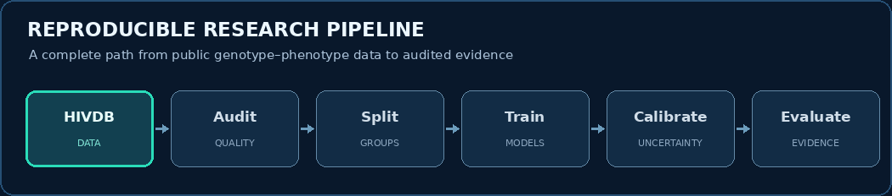
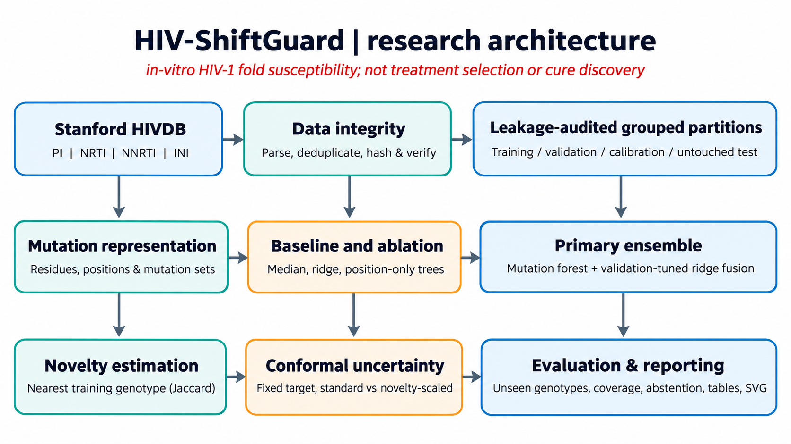
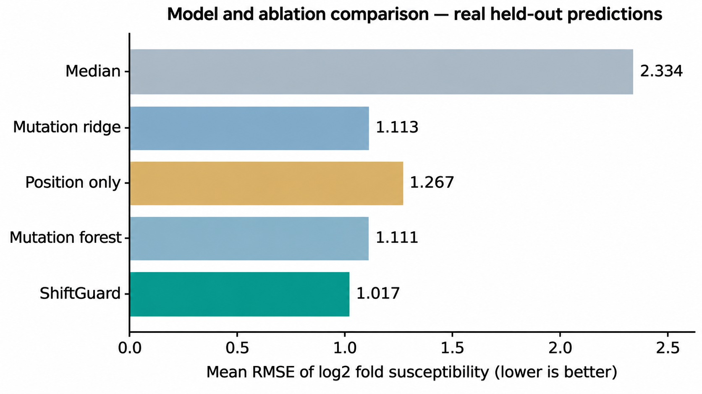
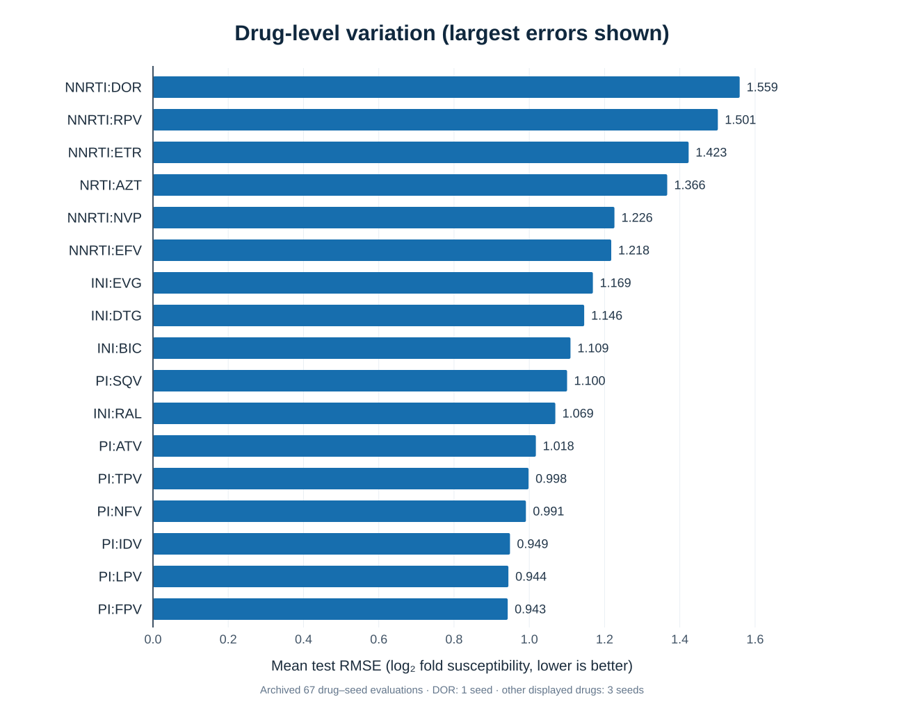
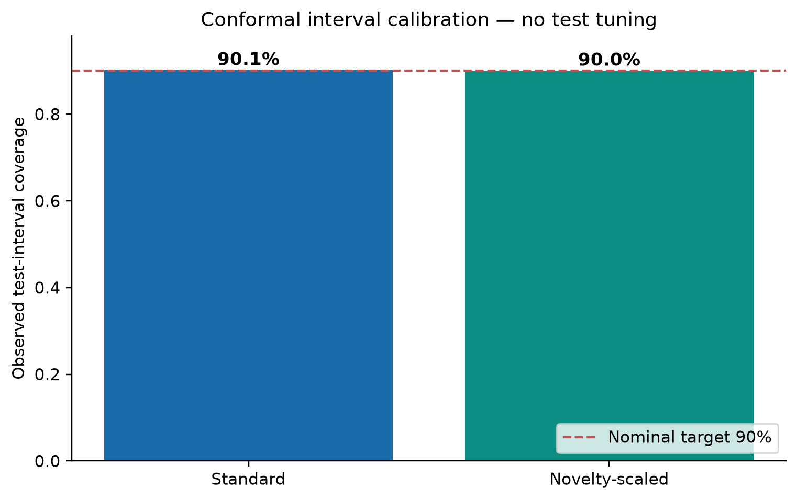
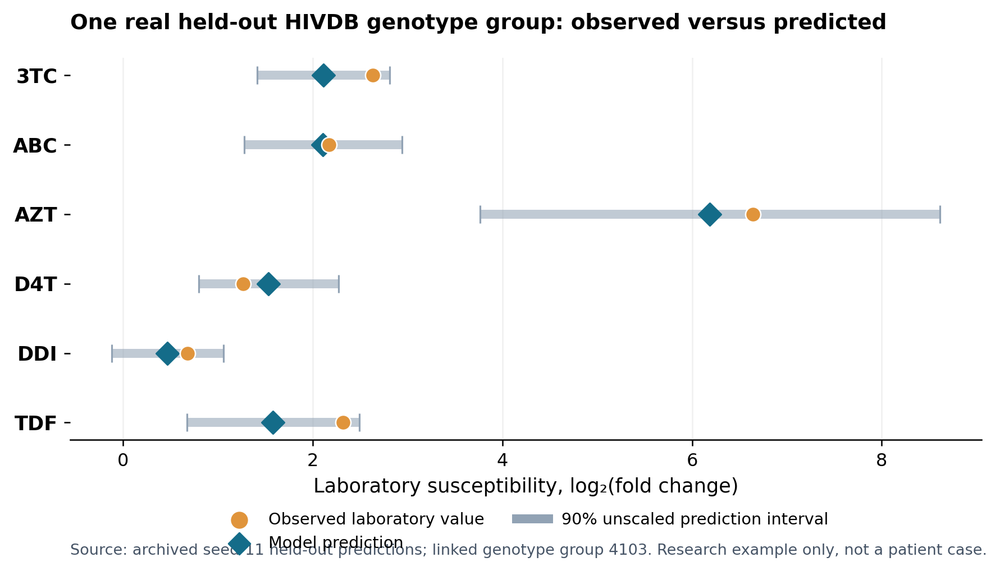

<div align="center">
  
  <p><strong>Open, auditable HIV-1 antiretroviral susceptibility research</strong></p>
  <p>
    <a href="docs/REPRODUCING.md">Reproduce</a> ·
    <a href="results/latest_report.html">Experiment report</a> ·
    <a href="paper/README.md">Manuscript</a> ·
    <a href="docs/index.html">Research overview</a>
  </p>
</div>

## What this research does

**HIV-ShiftGuard** estimates laboratory HIV-1 antiretroviral susceptibility (`log₂` fold-change) from viral mutation features. It compares ridge regression, extremely randomized trees and a validation-weighted ensemble, then audits uncertainty, mutation novelty and selective reporting. Its evidence is retrospective *in vitro* data from the [Stanford HIV Drug Resistance Database](https://hivdb.stanford.edu/pages/genopheno.dataset.html).

> **Research use only.** Predictions are not patient outcomes, treatment recommendations, medication rankings, or evidence of an HIV cure.

## Experimental snapshot

| Valid drug–isolate pairs | Drug-specific tasks | Completed drug–seed runs | Grouped isolates |
|:---:|:---:|:---:|:---:|
| **32,313** | **23 drugs** | **67 runs** | **5,043 groups** |

| Model | Mean test RMSE ↓ | Mean test MAE ↓ |
|---|---:|---:|
| Median baseline | 2.334 | 1.872 |
| Mutation ridge | 1.113 | 0.824 |
| Position-only trees* | 1.267 | 0.862 |
| Mutation forest | 1.111 | 0.759 |
| **HIV-ShiftGuard ensemble** | **1.017** | **0.719** |

*Position-only variant changes tree capacity, so it is an exploratory comparison rather than a controlled single-factor ablation.* These are equal-weighted averages across 67 matched drug–seed evaluations, **not** patient treatment-response estimates.

The **90% nominal** unscaled prediction intervals had **90.12% pooled coverage**; novelty-scaled intervals had **90.00%** and were slightly wider. Novelty scaling did **not** improve pooled interval efficiency.

## Pipeline

<div align="center"></div>

- **Input:** Stanford PI, NRTI, NNRTI and INI genotype–phenotype research files; downloaded at runtime, not redistributed.
- **Method:** Mutation tokens → connected-group splits → per-drug baselines and ensemble → conformal intervals → novelty/review-gate audit.
- **Reproducibility:** Seeds `11`, `23`, `37`; train / validation / calibration / test partitions; checkpointed per-drug runs; data SHA-256 provenance.

<details><summary><strong>Research architecture</strong></summary>



</details>

## Figures from the manuscript

<table>
<tr><td width="50%"><sub><b>Model comparison</b> · RMSE</sub></td><td width="50%"><sub><b>Drug-level variation</b> · RMSE</sub></td></tr>
<tr><td><sub><b>Uncertainty audit</b> · Coverage</sub></td><td><sub><b>Held-out laboratory example</b> · Not a patient case</sub></td></tr>
</table>

[Browse every figure](docs/assets/figures/) · [Inspect CSV result tables](results/tables/) · [Check experimental provenance](results/PROVENANCE.json)

## Run on Windows

```text
1. Download this repository as ZIP and extract it.
2. Double-click RUN_ALL.bat.
3. Open results/latest_report.html when the run finishes.
```

`RUN_ALL.bat` installs an isolated Python environment and dependencies, downloads the four Stanford files, runs tests, trains and evaluates models, generates figures/tables, and resumes completed checkpoints when rerun. Python 3.10+ and internet are required for a fresh run; the default pipeline runs on CPU, with no GPU required.

To independently verify **the archived** headline numbers without retraining:

```bash
python scripts/verify_results.py
```

[Full reproducibility instructions](docs/REPRODUCING.md) · [Research protocol](docs/RESEARCH_PROTOCOL.md) · [Original one-click user guide](docs/ORIGINAL_PIPELINE_GUIDE.md)

## Repository map

```text
HIV-ShiftGuard/
├── RUN_ALL.bat                  # Environment setup, training and resume
├── src/hivshiftguard/           # Data, models, evaluation, visualization
├── tests/                       # Isolated unit/regression tests
├── scripts/                     # Archived evidence verification
├── config.json                  # Seeds and experiment configuration
├── results/                     # Actual reported aggregate results
├── docs/                        # Protocol, visual assets and research site
└── paper/                       # Current paper metadata and prior-version archive
```

## Authors

Jasmine Kaur · Hossein Tabasi · **Alok Raj** (corresponding author) · Pankaj Vaidya · Anurag Rana  
Yogananda School of AI, Computers and Data Sciences, Shoolini University of Biotechnology and Management Sciences, India.

**Current manuscript:** [IEEE-format ICAAIC 2027 version and author details](paper/README.md). The older ICIRSET Word/PDF files remain archived for version history; they are not the current author list.

**Cite:** See [`CITATION.cff`](CITATION.cff). Source code is released under the MIT license; Stanford data and third-party material retain their own rights.
